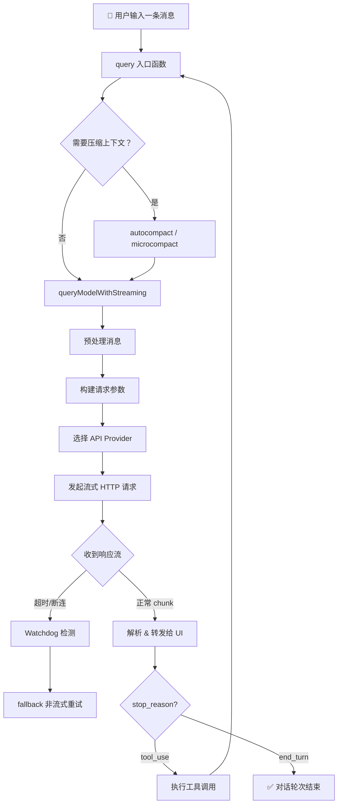
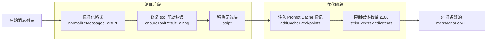
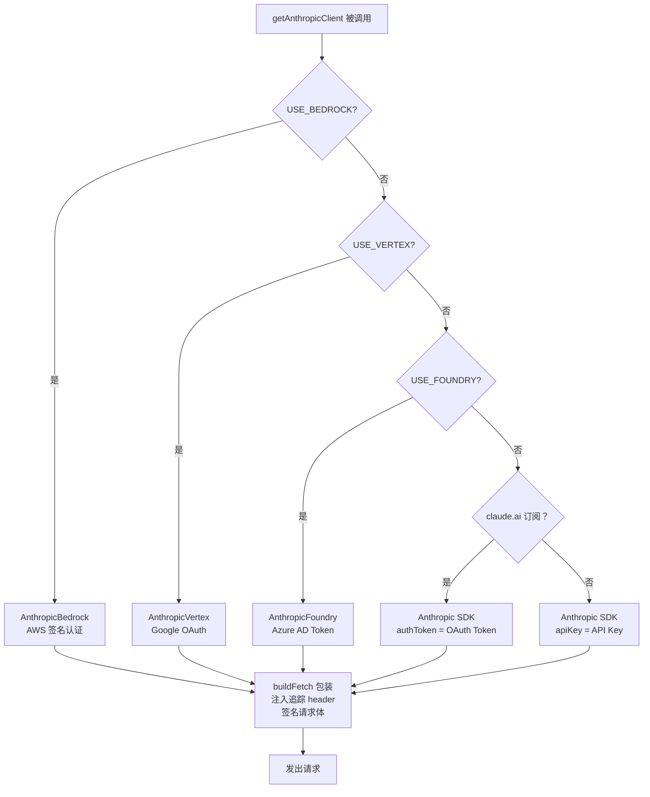
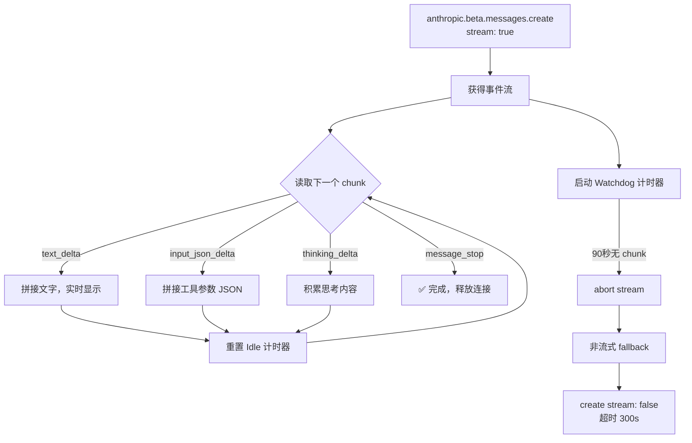
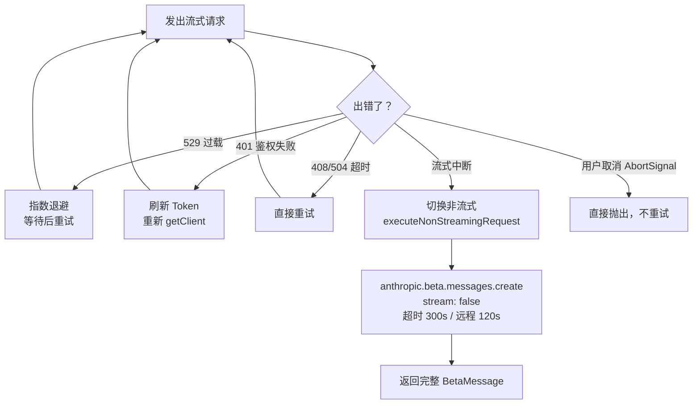

# cc-haha 对话模块：流程图与通俗讲解

> 仅聚焦对话模块（conversation module），以流程图 + 白话解释每个功能分类的实现思路。

---

## 第一部分：整体流程——一条消息的旅程



**通俗理解**：就像你发了一封信（消息），邮局（query）先检查信封重量（上下文长度），太重就先压缩，然后把信投进不同的邮政系统（Provider），收到回信后一段一段地实时念给你听（流式），如果中途断了就换普通信件（非流式 fallback）重发。

**对应代码位置**：
- 入口：`src/query/deps.ts` — `QueryDeps.callModel`
- 流式函数：`src/services/api/claude.ts:757` — `queryModelWithStreaming`
- 核心私有函数：`src/services/api/claude.ts:1022` — `queryModel`

---

## 第二部分：消息预处理——发出去之前做了什么



**通俗理解**：类似发邮件前的自动检查——检查格式、修掉不完整的引用、删掉多余的附件，最后打上"可缓存"标签省钱。

**七道处理工序**：

| 序号 | 函数 | 作用 |
|---|---|---|
| 1 | `normalizeMessagesForAPI` | 统一消息格式，合并相邻同类块 |
| 2 | `stripToolReferenceBlocks...` | 非 tool search 模式下移除 tool_reference 块 |
| 3 | `stripCallerField...` | 移除 tool_use 的 caller 字段 |
| 4 | `ensureToolResultPairing` | 修复孤立的 tool_use / tool_result（断点续传场景） |
| 5 | `stripAdvisorBlocks` | 无 advisor beta 时移除 advisor 块 |
| 6 | `stripExcessMediaItems` | 媒体项超 100 个时静默删最旧的（API 硬限制） |
| 7 | `addCacheBreakpoints` | 注入 prompt cache 控制标记（降低 API 费用） |

---

## 第三部分：API Provider 选择——走哪条路



**通俗理解**：就像打车选平台——滴滴/优步/高德都能到目的地，但登录方式不同。无论走哪条路，最后都会给请求加上"快递单号"（x-client-request-id）方便查问题。

`buildFetch` 做的两件事：
1. 注入 `x-client-request-id`：每次请求生成唯一 UUID，超时时没有服务端 request-id 也能关联日志
2. `signClaudeCodeCCHBody`：对请求体签名，防止滥用

---

## 第四部分：流式响应处理——接收回信



**通俗理解**：就像收广播——每收到一个字就立刻显示，同时有个"看门狗"计时器，如果超过 90 秒没收到任何内容，就断开重连，改用"一次性发完"的方式。

**为什么不用 `BetaMessageStream`**：官方 SDK 的高层封装会对每个 `input_json_delta` 调用 `partialParse()`，当工具参数很长时产生 O(n²) 性能问题。cc-haha 改用底层 `.create({ stream: true })` 自行积累 tool input，性能更好。

**Watchdog 两个计时器**：

| 计时器 | 是否被 chunk 重置 | 目的 |
|---|---|---|
| Idle timer（默认 90s） | 是 | 检测连接静默挂起 |
| Max duration timer（默认禁用） | 否 | 防止服务端一直发小 delta 永不结束 |

---

## 第五部分：Beta Headers——功能开关机制

```mermaid
flowchart LR
    subgraph 会话级 latch（一旦开启本会话内不变）
        L1[Fast Mode]
        L2[Cache Editing]
        L3[AFK / Auto Mode]
    end

    subgraph 每次请求动态判断
        D1[Prompt Caching]
        D2[Tool Search]
        D3[Structured Outputs]
        D4[Extended Thinking]
    end

    L1 & L2 & L3 & D1 & D2 & D3 & D4 --> BETAS[betas: betasParams\n发送给 API]
```

**通俗理解**：Beta Headers 是给服务端的"功能开关暗号"。

- **latch 类**：一旦打开就不能在本次会话里关掉——因为关掉会导致服务端的 prompt cache key 变化，让已缓存的内容全部失效，用户等待时间变长。
- **动态类**：每次请求都根据当前状态重新判断，灵活可变。

---

## 第六部分：重试与降级策略



**通俗理解**：遇到问题不同的处理方式——过载了就等等再试，身份过期了就先换证，超时了直接重来，流断了就换挂号信，用户自己取消了就停下来。

---

## 功能分类汇总

| 分类 | 核心文件 | 作用 |
|---|---|---|
| 入口调度 | `src/query/deps.ts` | 依赖注入，组织调用顺序 |
| 消息预处理 | `claude.ts` 内部 | 清理、修复、优化消息列表 |
| 客户端创建 | `services/api/client.ts` | 多 Provider 工厂 + 鉴权 |
| 请求参数构建 | `claude.ts: paramsFromContext` | 动态组装 API 参数 |
| 实际 API 调用 | `claude.ts: queryModel L1889` | `anthropic.beta.messages.create` |
| 流式处理 | `claude.ts` 内部 | chunk 解析 + watchdog |
| 重试降级 | `services/api/withRetry.ts` | 错误分类 + 重试策略 |
| 上下文压缩 | `services/compact/*` | 防止超出 context 窗口 |
