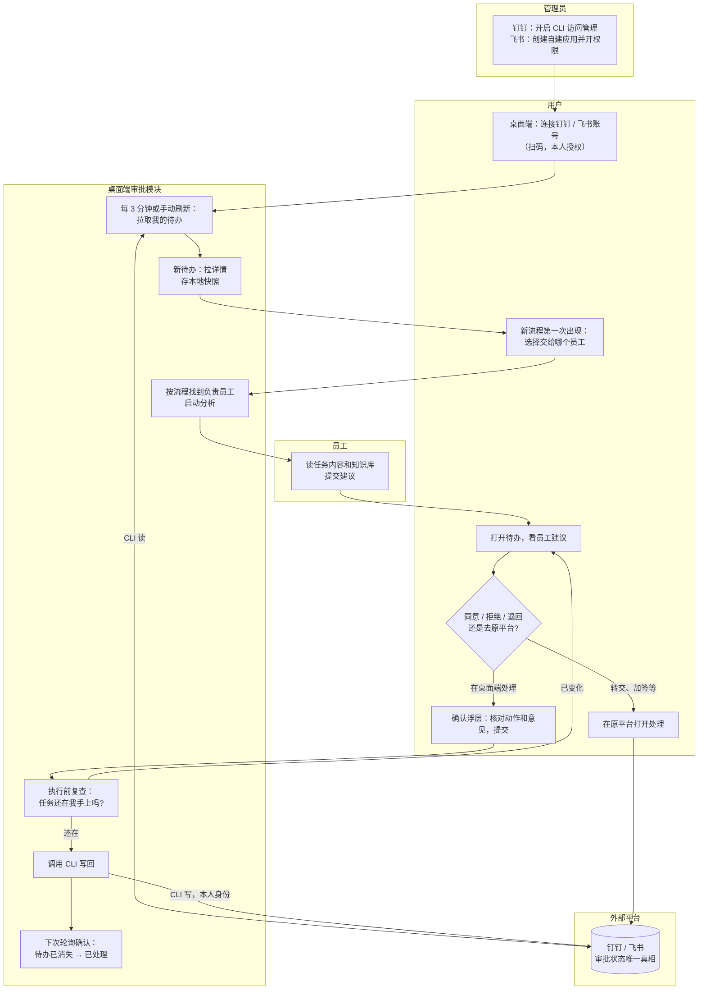
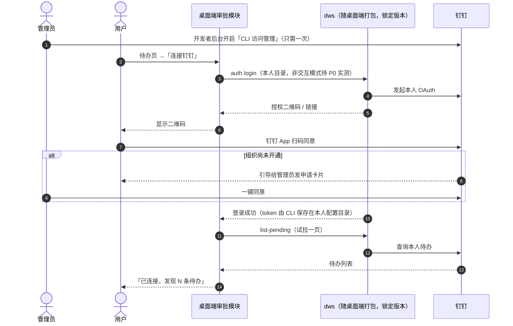
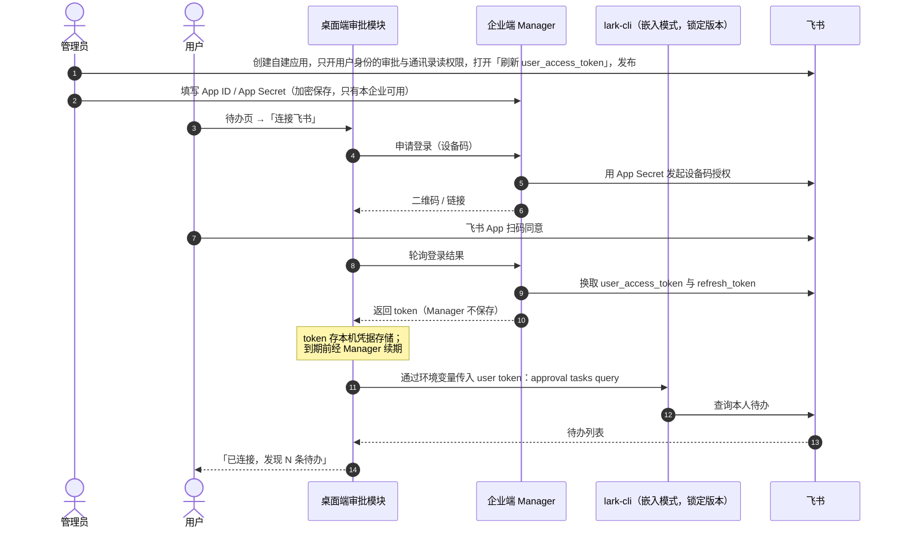
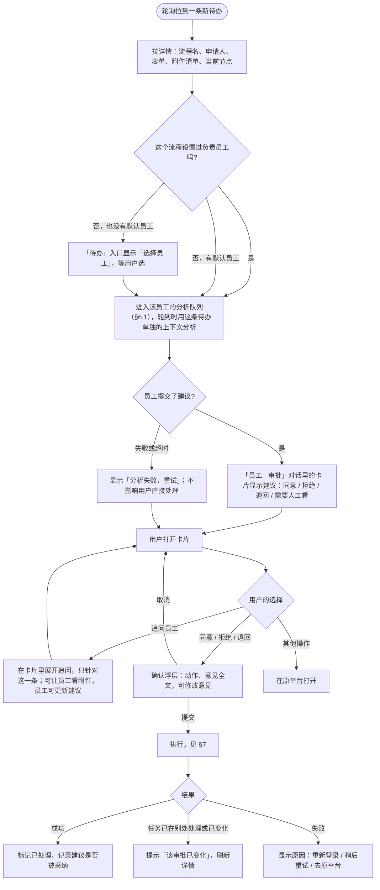
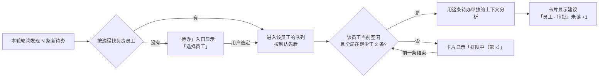
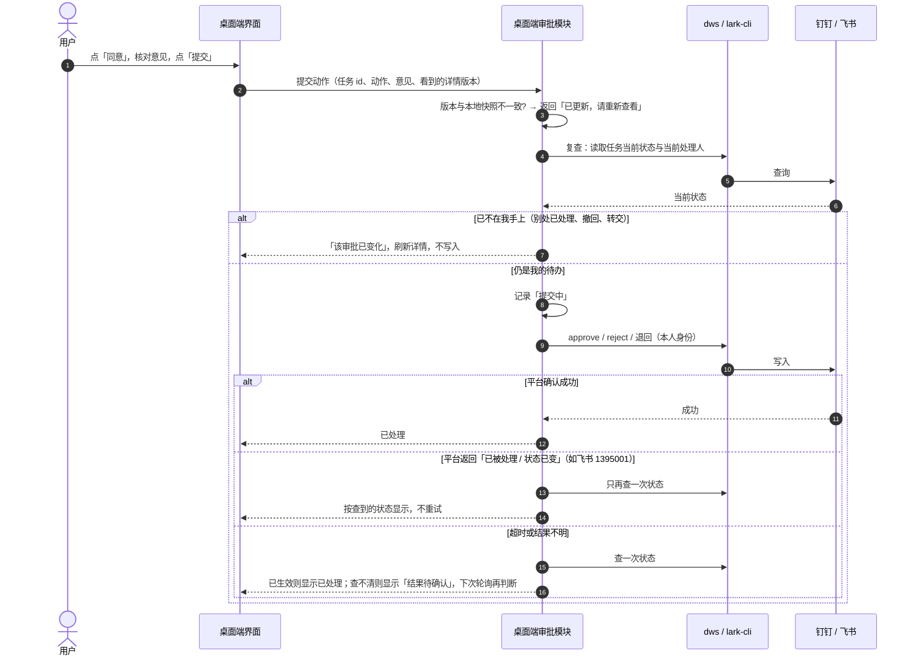
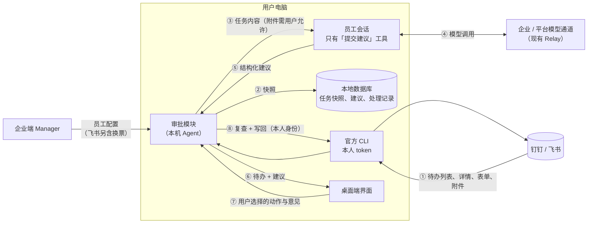
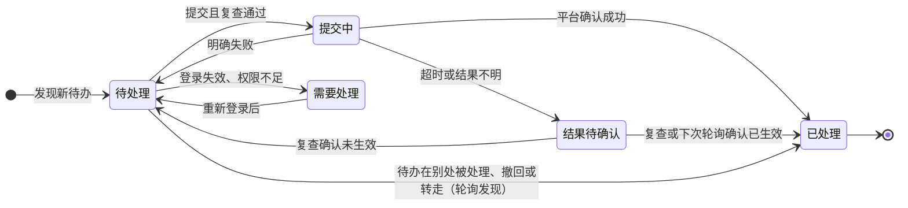

# 外部审批平台接入：业务流程（钉钉、飞书 P0）

> 状态：**owner 已确认（2026-11-28）**，§14 五项决策均按建议，另加「审批对话」展示方式（§6.1）。需求与设计、UI 交互方案、数据流转、实施计划四篇文档据此改写。
> 目标（owner 2026-11-28）：接入更简单、系统更稳定、改动更小、更安全、用户用着更舒服。原方案中能推翻的先推翻。
> 平台范围：钉钉（官方 CLI `dws`）、飞书（官方 CLI `lark-cli`）进 P0；氚云等厂商确认第三方接入后再定；企业微信官方 CLI 没有审批，暂不接入。
> 依据：调查报告与 2026-11-28 四平台调研（dws v1.0.69、lark-cli v1.0.100 / lark-approval v1.2.0）。标「P0 实测」的地方尚未验证。

## 1. 一句话

审批仍在钉钉、飞书里完成，平台上的状态说了算。桌面端只把「我的待办」拉过来，交给对应的员工先看一遍、给出建议；用户在桌面端点「同意 / 拒绝 / 退回」，桌面端用**用户本人账号**调用官方 CLI 写回平台。

## 2. 相对原方案的取舍

| 方面 | 原方案 | 新方案 | 理由 |
|---|---|---|---|
| 平台层 | 9 个方法的通用插件接口，核心不感知平台，另做 fake 插件 | 每个平台一个**薄适配器**，只调用官方 CLI 的固定几条命令：列待办、读详情、取附件、执行动作、复查状态 | 认证、分页、错误码已由官方 CLI 封装，我们写得少，也就错得少；第三个平台再加一个适配器即可 |
| 认证 | 复用 `McpCredentialStore`；企业应用 Secret 由谁托管待定 | 钉钉：用户扫码走 dws 的本人 OAuth，管理员在后台开启「CLI 访问管理」；飞书见待决策 #1 | 钉钉侧我们不保管任何企业密钥 |
| 收待办 | 推送 + 轮询，长连接事件进程，常驻要求 | **只轮询**：桌面端开着时每 3 分钟拉一次，打开待办页或点「刷新」时立即拉；事件订阅以后再加 | 不需要常驻的事件进程，断线、重复、乱序、飞书退出后不退订这些问题都不会出现 |
| 动作 | 按流程透传全部动作；参数候选搜索；动作白名单 | 固定 3 个：**同意、拒绝、退回发起人**（退回能否用待 P0 实测）；转交、加签等一律「在原平台打开」 | 界面统一，不需要人员搜索，不需要参数表单 |
| 流程配置 | 模板列表与预览、节点、字段白名单、规则集、处理模式 | 只维护一张「流程 → 员工」对应表；某个流程第一次出现时问一次交给谁，没设置的交给默认员工 | 配置一步完成，不需要模板接口 |
| 制度与规则 | Manager 下发规则集与制度文件，规则集来自 Operator 的行业模板，新增跨端接口 | 直接用员工在企业端已有的人设、技能和知识库 | 不新增跨端接口；企业照现有方式维护员工即可 |
| 员工分析 | 只读会话加 3 个工具；群聊；四层依据链 | 每条待办单独一份分析上下文，员工只有 1 个工具「提交建议」；建议以卡片出现在该员工名下的「审批」对话里，追问在卡片里展开，只针对这一条（§6.1） | 复用私聊的列表与会话能力，不做群聊；普通私聊不受影响 |
| 自动放行 | 有条件自动放行、一键暂停、放权变更走原生框 | **首版不做**，每一次写回都由用户本人点击 | 这是原方案最大的风险来源，也是最大的复杂度来源 |
| 确认 | 一次性确认票据、宿主私有通道、高风险原生框、风险等级计算 | 用户点动作按钮后弹出确认浮层，显示动作名和意见全文，点「提交」后执行；执行前桌面端再查一次，确认任务仍在我手上 | 见待决策 #2 |
| 状态与记录 | 5 个状态加原因码；只追加的执行记录加哈希；跨设备幂等键 | 任务只有 3 个状态（见 §9）；每次处理记一条记录；防重复靠「执行前复查」加「平台拒绝已处理的任务」 | 外部平台本身就是唯一真相，本地不再维护第二套状态 |
| 申请人预检 | 原 §16 | 移出本专题 | 与审批人主链无关，以后单独评审 |
| 改动面 | 本地接口 24 个，本地表 3 张（预检另 1 张），跨端接口若干 | 本地接口 11 个，本地表 3 张（每张都更窄），钉钉侧不改跨端接口 | 见 §12 |

保留不变的部分：内容只留在本机、不上传；模型没有任何写回能力；执行前复查；用户本人身份写回，平台审计记在本人名下；员工的会话里不装 dws 或 lark-cli 自带的 agent 技能。

## 3. 参与方

| 参与方 | 做什么 | 不做什么 |
|---|---|---|
| 企业管理员 | 钉钉：开启「CLI 访问管理」。飞书：创建自建应用并开权限（见待决策 #1）。在企业端照常配置员工 | 不在我们系统里配置审批规则 |
| 用户（审批人） | 在桌面端连接账号，设置流程交给哪个员工，查看建议，点同意、拒绝或退回 | — |
| 桌面端审批模块（在本机 Agent 内） | 轮询待办、拉详情、启动员工分析、执行用户点的动作、执行前复查、记录 | 不自己做审批判断；不自动提交 |
| 员工（本地 Pi 会话） | 读任务内容，结合自己的知识库，提交建议（建议动作、理由、缺什么、草拟意见） | 不能调用 CLI，不能写回，没有 bash 和文件写入工具 |
| 官方 CLI（dws / lark-cli） | 以用户本人身份访问平台 | 不对模型开放，不在系统 PATH 上 |
| 外部平台（钉钉 / 飞书） | 审批的真相：待办、状态、审计 | — |
| 企业端 Manager | 下发员工配置（现有能力）；飞书方案 A 下另负责换取用户 token | 不接收审批内容 |

## 4. 端到端业务流程（总图）

流程配置只在某个流程第一次出现时问一次，之后同一流程的新待办直接交给负责员工分析，不再询问。

## 5. 开通与连接流程

### 5.1 钉钉

### 5.2 飞书（方案 A，owner 已确认）

## 6. 日常处理流程

说明：

- 分析在拿到新待办后自动进行，用户打开时建议通常已经准备好。是否自动分析可以按流程关闭。
- 附件默认不发给员工。用户在卡片的追问里点「让员工看附件」后，桌面端临时下载附件交给员工，分析结束后立即删除。
- 有缺失材料时，建议区会显示缺什么，「退回」按钮排在最前，但不会替用户做选择。

### 6.1 多条待办同时到达（owner 2026-11-28 确认）

展示：每个负责审批的员工，在左侧对话列表里多一条「员工名 · 审批」对话（带审批角标，做法同自动化任务的执行会话），未读数是「有新建议、用户还没看过」的待办条数。每条待办在这个对话里是一张卡片：流程名、申请人、关键字段、员工建议，卡片上直接点同意、拒绝、退回、追问，或在原平台打开。和该员工的普通私聊完全分开：普通私聊里员工有执行命令、写文件等工具，审批内容不进那里的上下文。

另有一个「待办」入口汇总所有员工的待办（同一种卡片），还没有负责员工的待办只在这里出现，并显示「选择员工」。点汇总里的卡片会跳到对应员工的「审批」对话。

排队规则：

| 规则 | 内容 | 原因 |
|---|---|---|
| 上下文隔离 | 每条待办一份独立的分析上下文，追问也只在这份上下文里 | 多条审批互不串；一条审批表单里的文字影响不到另一条 |
| 每个员工一次一条 | 同一员工的待办按到达先后依次分析 | 和员工「一个人看材料」的直觉一致，也避免同一员工同时占用多份模型额度 |
| 全局最多同时 2 条 | 不同员工之间可以并行，但总数最多 2 条 | 控制本机资源和模型调用量 |
| 用户可插队 | 用户在某张卡片上点「先分析这条」或展开追问，这条排到最前 | 用户正在看的优先 |
| 刚连上账号 | 只自动分析最近 20 条待办，其余卡片显示「点此分析」 | 避免一连上就把几十条历史待办全部送去分析 |
| 已在别处处理 | 还在排队的直接移出队列；卡片收起为「已在钉钉 / 飞书处理」 | 不浪费分析 |
| 员工被停用 | 该员工队列里的待办退回「待办」入口，显示「重新选择员工」 | 见 §10 |

同一流程同时来多条，各自一张卡片，不合并，不批量处理（首版不做批量同意）。

## 7. 处理（写回）时序

防重复：同一任务在「提交中」时界面按钮不可点，本模块拒绝重复提交；跨设备的重复提交，由执行前复查加平台拒绝已处理任务兜底。结果不明时一律不自动重试。

## 8. 业务流转图（数据怎么走）

| 步骤 | 数据 | 存在哪 | 离开本机吗 |
|---|---|---|---|
| ① | 流程名、申请人、提交时间、表单字段值、附件清单、当前节点与处理人、操作记录与意见 | 只在内存里过一下 | — |
| ② | 上述内容的快照（附件只存清单） | 本地数据库 | 否 |
| ③④ | 任务内容；用户允许后加上附件正文 | 会话记录在本地 | 只发给企业已选定的模型通道，和现有私聊一样 |
| ⑤⑥ | 建议动作、理由、缺失材料、草拟意见 | 本地数据库 | 否 |
| ⑦⑧ | 动作与意见 | 本地处理记录 | 只发给钉钉 / 飞书 |
| 治理 | 只有次数类的脱敏统计（是否上报，按现有治理口径另定） | — | 只有摘要 |

两个平台能拿到的数据：

| 数据 | 钉钉 dws | 飞书 lark-cli |
|---|---|---|
| 我的待办列表 | `oa approval list-pending`（每页最多 100 条） | `approval tasks query`（topic=1 表示待办） |
| 详情与表单 | `detail`：表单字段值、发起人、流程信息 | `instances get`：流程名、表单、当前节点与类型、各节点处理人 |
| 我的任务 id | `tasks`（taskId） | `instances get` 里 `current_nodes[].approvers[].task_id` |
| 操作记录与意见 | `records` | `operation_records`、`comments` |
| 附件 | `attachment download-url`（临时链接） | 表单附件控件，取法待 P0 实测 |
| 节点名、处理人姓名 | 待 P0 实测 | 返回中直接带 |

## 9. 任务状态

只持久化三种主状态：`open`（待处理，含提交中与结果待确认这两个子步骤，记在处理记录里）、`done`（已处理，附带「在这里处理」或「在别处处理」）、`attention`（需要处理，附原因）。「分析中」「有建议」「提交中」都由会话和处理记录推导出来，不写进主状态。

## 10. 异常与处理

| 情况 | 用户看到 | 系统怎么做 |
|---|---|---|
| 登录过期 / 被撤销 | 顶部提示「钉钉登录已过期，重新连接」 | 暂停轮询，保留已有任务；重新连接后立即同步 |
| 管理员未开通（钉钉） | 「需要管理员开启 CLI 访问」，并显示申请入口 | dws 自带的申请卡片流程 |
| 被平台限流 | 「同步稍慢」 | 按平台返回的时间延后重试；轮询间隔自动加长 |
| 任务在别处已处理 | 列表中移到「已处理（在钉钉处理）」 | 轮询发现后关闭本地入口 |
| 提交时任务已变化 | 「该审批已变化」，详情刷新 | 不写入，不重试 |
| 结果不明 | 「结果待确认」 | 查一次状态，查不清就等下次轮询 |
| 员工分析失败 | 「分析失败，重试」，动作按钮照常可用 | 不影响处理 |
| 员工不可用（被企业停用） | 「负责员工不可用，重新选择」 | 不再分析该流程的新待办 |
| CLI 输出格式变化 | 「同步失败，请升级桌面端」 | 锁定 CLI 版本；用契约测试保证升级前发现问题 |
| 桌面端没开 | 打开后才看到新待办 | 启动时立即同步 |

## 11. 两个平台的命令对照

| 步骤 | 钉钉 dws | 飞书 lark-cli（`--as user`） |
|---|---|---|
| 连接 | `dws auth login`（本人 OAuth） | 设备码登录（方案 A 经 Manager 换票），user token 通过环境变量传入 |
| 列待办 | `dws oa approval list-pending --page --limit 100` | `lark-cli approval tasks query`（topic=1） |
| 详情 | `dws oa approval detail --instance-id` + `tasks` + `records` | `lark-cli approval instances get` |
| 附件 | `dws oa approval attachment download-url --instance-id --file-id` | 待 P0 实测 |
| 同意 / 拒绝 | `approve` / `reject --instance-id --task-id --remark` | `approval tasks approve` / `reject` |
| 退回发起人 | 先 `revert-activities`，再 `revert-task --target-activity-id sid-startevent --action REVERT_FOR_RESUBMIT` | `approval tasks rollback`（目标 `START`） |
| 复查 | `tasks --instance-id`：看我的 taskId 是否仍待处理 | `instances get`：看我的 task 状态；错误码 `1395001` 表示已变化 |

命令参数按锁定的版本写进适配器，不让模型生成命令。

## 12. 改动面（粗估）

| 位置 | 改动 | 量级 |
|---|---|---|
| `server/agent_service`（本机 Agent） | 新增审批模块：轮询定时器（审批模块自带；`src/schedule.ts` 是会话定时发提示词用的，不复用）、两个 CLI 适配器、任务与处理记录、分析会话（复用私聊，限定工具为「提交建议」）；本地接口 11 个；全局事件流（`/api/agent/events`）新增一种事件，界面断线重连后刷新列表，沿用现有约定 | M |
| `clients/desktop` | 对话列表新增「员工 · 审批」对话类型与审批卡片（建议、动作按钮、卡片内追问、确认浮层），「待办」汇总入口，连接向导，流程 → 员工设置；在 Tauri 资源中打包锁定版本的 dws / lark-cli（不放进 PATH） | M |
| 企业端 Manager | 钉钉：不改。飞书方案 A：新增飞书应用配置（查看、保存 2 个接口 + 企业设置里 1 个表单）和换票（发起设备码、换票 / 刷新 2 个接口），不保存用户 token | S |
| 运营端 | 不改 | — |

本地表 3 张：`ext_approval_connection`（平台、成员、连接状态、最近同步时间、流程 → 员工对应）、`ext_approval_task`（快照、建议、主状态、会话 id）、`ext_approval_action`（每次处理一条：动作、意见、建议是否被采纳、结果）。

## 13. 不能保证的事

- 桌面端关闭时收不到新待办，也不会分析；打开后才同步。
- 本机同一系统账户下的其他程序，理论上能读到 CLI 的登录凭据。审批分析会话没有 bash，CLI 也不在 PATH 上，这只能降低风险，挡不住用户自己装的恶意程序，或员工在其他「完全访问」会话里执行的命令。
- 员工的建议可能出错，最后由用户本人判断。
- 平台 CLI 和接口会变。我们锁定版本，升级前跑契约测试，但平台服务端的变化无法提前预知。
- 平台的限流、配额、意见长度上限以 P0 实测为准。

## 14. 决策（owner 2026-11-28 已确认，均按建议）

| # | 事项 | 选项 | 结论 | 影响 |
|---|---|---|---|---|
| 1 | 飞书的应用密钥放在哪 | A：放企业端 Manager，桌面端登录和续期时经 Manager 换票，Manager 不保存用户 token。B：下发到每台桌面（最省事，但企业级密钥会落到员工电脑上，违反现有红线）。C：每个用户自建一个应用（管理员要审核很多个应用，不现实） | **A** | 飞书适配器、Manager 改动 |
| 2 | 写回前怎么确认 | A：所有动作都用桌面端确认浮层（显示动作和意见全文），不再做风险分级和系统原生框。B：保留原裁决，拒绝和退回改用系统原生框 | **A**。理由：首版没有自动放行，模型也没有写回能力，剩下的风险只有界面被注入脚本，而这是整个应用的共同风险，不该只在这里单独处理 | 确认交互、宿主改动 |
| 3 | 首版的动作范围 | A：同意、拒绝、退回发起人（退回待 P0 实测）。B：只做同意和拒绝 | **A**。缺材料是常见的退回原因，退回不能用时自动降级为 B | 适配器、UI |
| 4 | 原方案文档怎么处理 | A：停止第六轮剩余修改（#4–#7），丢弃未提交的 #1–#3，按本稿整体改写四篇文档，并在 PR 上发一条说明。B：保留旧稿，另开新 PR | **A**（第六轮 #1–#3 未提交改动已丢弃） | 文档改写 |
| 5 | 默认轮询间隔 | 3 分钟；P0 按平台限流调整 | **3 分钟** | P0 |
| 6 | 多条待办同时到达时建议在哪展示 | A：员工名下单独的「审批」对话。B：放进普通私聊（员工有执行命令等工具，审批内容进上下文有被诱导的风险，多条会互相串）。C：每条待办一个对话（列表会刷屏） | **A**，排队规则见 §6.1 | UI、分析队列 |

## 15. P0 要实测的事（出口条件）

每一项都要留下证据：命令、返回样例、平台审计截图。

1. 钉钉、飞书分别用本人身份完成：列待办、读详情、同意、拒绝、退回发起人；平台审计里的操作人是本人。
2. 复查：任务在别处处理后，复查能识别出来；飞书 `1395001`、钉钉相应的错误码能被识别。
3. 轮询：每 3 分钟一次、持续 8 小时，不被限流，也不出现他人的待办。
4. 登录：dws 能以非交互方式拿到二维码或链接；飞书设备码走 Manager 换票、经环境变量传 token，能持续续期 7 天以上。
5. 多人共用一台电脑：每个本机成员使用独立的 CLI 配置目录，互不串号（目录参数或环境变量需要实测确认）。
6. 附件：两个平台都能下载附件。
7. 意见长度上限、中文和换行能否原样写入。
8. 打包：两个 CLI 在 macOS 和 Windows 上随桌面端分发的体积，以及签名和公证是否可行。

任一平台第 1 项不通过：该平台首版只做「看待办 + 员工建议 + 在原平台打开」，不做写回。
